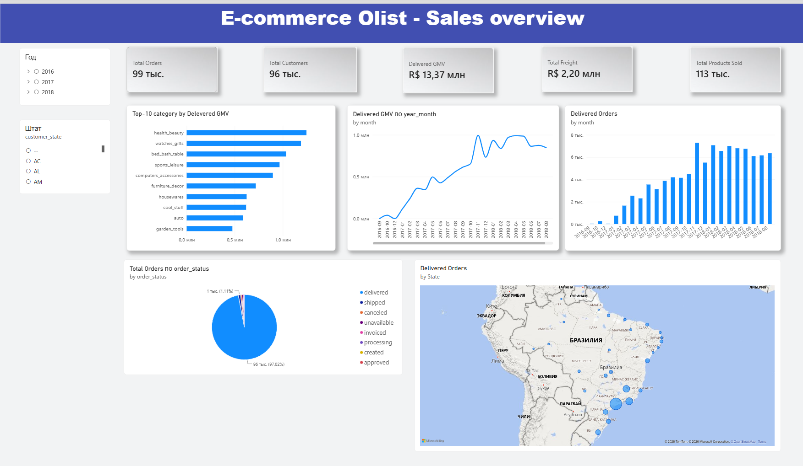
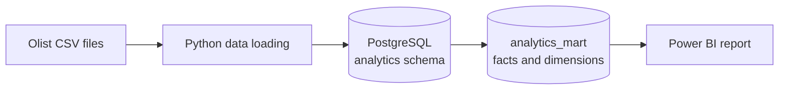

# E-commerce Sales & Operations Analytics

<p align="left">
  
  
  
  
</p>

An end-to-end data analytics portfolio project based on the **Brazilian E-Commerce Public Dataset by Olist**. The project explores marketplace sales and order operations, from data ingestion and quality checks to PostgreSQL analytical models and an interactive Power BI report.

## Dashboard preview



*Current report page: Sales Overview.*

The Power BI `.pbix` file is best published as an asset on the repository's [Releases](https://github.com/MatveyB1105/E-commerce-Sales-Operations-Analytics) page rather than committed to the normal Git history.

## Project objectives

The goal is to turn raw marketplace data into a reliable analytical layer and answer practical business questions:

- How do delivered GMV and delivered order volumes change over time?
- Which product categories contribute the most to delivered GMV?
- How are orders distributed across statuses?
- Which Brazilian states account for the largest number of delivered orders?
- How can order-level and item-level data be modelled without inflating metrics?

## Dataset

**Source:** [Brazilian E-Commerce Public Dataset by Olist — Kaggle](https://www.kaggle.com/datasets/olistbr/brazilian-ecommerce)

The dataset contains approximately 100,000 orders placed between **2016 and 2018**. It includes related data about orders, order items, customers, products, sellers, payments, reviews and geolocation.

The raw dataset is not stored in this repository. Download it from Kaggle and follow the local loading instructions in the project scripts.

## Tech stack

| Tool | Purpose |
|---|---|
| PostgreSQL | Relational database, data validation, transformations and analytical views |
| SQL | Joins, aggregations, CTEs, window functions, data-quality checks and business metrics |
| Python | Dataset loading and ingestion automation (`load_data.py`) |
| Power BI | Interactive reporting, KPI measures and business analysis |

## Workflow and architecture



### Data preparation and modelling

1. Load the source CSV files into PostgreSQL.
2. Validate data quality: missing values, duplicate keys, invalid values and relationships between tables.
3. Apply appropriate data types and define primary and foreign key constraints where the source data supports them.
4. Build an analytical layer in the `analytics_mart` schema.
5. Use the analytical layer to calculate business metrics and build Power BI visuals.

The model distinguishes between different levels of detail:

- `fact_orders` - one row per order.
- `fact_order_items` - one row per order item (`order_id` + `order_item_id`).

This distinction is important: joining multiple fact tables at their raw grain can duplicate rows and overstate sums or counts. Measures should be calculated at the correct grain or after pre-aggregation.

## Power BI - Sales Overview

The current report page contains:

| Visual | Business purpose |
|---|---|
| KPI cards | Monitor orders, customers, delivered GMV, freight and products sold |
| Delivered GMV by month | Track monthly sales value over time |
| Delivered orders by month | Compare monthly order volumes |
| Top 10 categories by delivered GMV | Identify the categories with the largest merchandise value |
| Order status distribution | Understand the composition of all order statuses |
| Delivered orders by state | Explore the geographical distribution of delivered orders in Brazil |

### Metric definitions and analytical rules

- **Delivered GMV** is calculated as the sum of item `price` for delivered orders. Freight is analysed separately; GMV is not profit.
- **Order status distribution** includes all order statuses, while delivered-only visuals use `order_status = 'delivered'`.
- **Orders** are counted distinctly by `order_id`.
- Customer counts should use the stable `customer_unique_id` when the business question is about unique buyers rather than order-level customer records.
- Every KPI should have a clearly defined population (all orders vs. delivered orders) and a numerator/denominator that refer to the same population.

## Repository structure

```text
.
├── dashboards/
│   └── screenshots/
│       └── sales-overview.png
├── data/                 # Local dataset files / download notes
├── sql/                  # SQL scripts for validation, modelling and analysis
├── load_data.py          # Python data-loading script
├── requirements.txt      # Python dependencies
├── .gitignore
└── README.md
```

## Reproducing the project

1. Download the Olist dataset from [Kaggle](https://www.kaggle.com/datasets/olistbr/brazilian-ecommerce).
2. Set up a local PostgreSQL database and configure the connection used by `load_data.py`.
3. Install the Python dependencies:

   ```bash
   python -m venv .venv
   ```

   Activate the virtual environment, then run:

   ```bash
   pip install -r requirements.txt
   ```

4. Load the source data using the project loader and execute the SQL scripts in the `sql/` directory in the order described in their filenames or comments.
5. Open the Power BI report and connect it to your local PostgreSQL analytical schema.

## Author

**MatveyB1105** · [GitHub profile](https://github.com/MatveyB1105)
